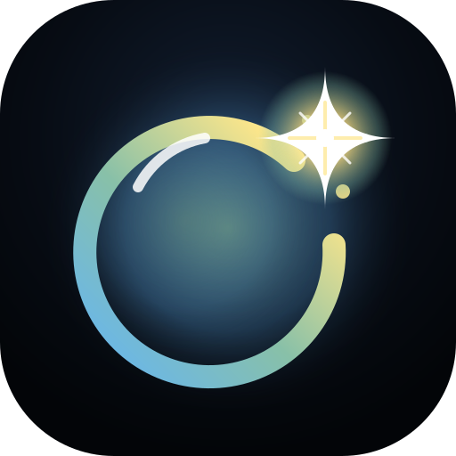

<div align="center">
  
  <h1>Pop</h1>
  <p><strong>Pop the digital fog bubble. A 2-minute, science-backed cognitive reset to dissolve overstimulation, down-regulate your nervous system, and reclaim deep focus.</strong></p>

  <p>
    <a href="https://github.com/Harixomxsingh/pop/releases"></a>
    <a href="./LICENSE"></a>
    <a href="https://developer.mozilla.org/en-US/docs/Web/JavaScript"></a>
    <a href="https://web.dev/progressive-web-apps/"></a>
    <a href="https://github.com/Harixomxsingh"></a>
  </p>

  <p>
    <a href="#-the-problem-neurobiology-of-digital-brain-fog">The Problem</a> •
    <a href="#-how-pop-works-the-pull-sanctuary">How It Works</a> •
    <a href="#-the-7-stage-recovery-protocol">7-Stage Protocol</a> •
    <a href="#-scientific-foundations--research-matrix">Scientific Research</a> •
    <a href="#-engineering--architecture">Architecture</a> •
    <a href="#-quick-start--local-development">Quick Start</a> •
    <a href="#-design-philosophy">Design Philosophy</a> •
    <a href="#-roadmap">Roadmap</a> •
    <a href="#-license">License</a>
  </p>
</div>

---

## 🌪️ The Problem: Neurobiology of Digital Brain Fog

Consuming short-form, algorithm-driven digital media (Instagram Reels, TikTok, YouTube Shorts, X feeds) leaves users in a recognizable, debilitating cognitive state known as **digital brain fog** or **attentional fragmentation**.

```
[ Algorithmic Binging ] ───► [ Dopamine Depletion ] ───► [ Tunnel Vision & Stress ] ───► [ Prefrontal Exhaustion ]
                                                                                                  │
                                                                                       [ Digital Brain Fog ]
```

When you scroll for 30–60 minutes, three specific biological breakdowns happen concurrently:

1. **⚡ The Dopamine Crash**: Rapid-fire novelty spikes release intense bursts of dopamine. When you stop scrolling, dopamine levels plummet below baseline, resulting in acute apathy, lethargy, and lack of motivation.
2. **👁️ Screen Tunnel Vision (Focal Vigilance)**: Staring at a 6-inch screen held 10 inches from your eyes locks your visual field into a narrow focal point. In human neurobiology, narrow visual focus activates the **locus coeruleus** in the brainstem, triggering low-grade noradrenaline release and keeping the autonomic nervous system in stress vigilance.
3. **🌪️ Directed Attention Fatigue (Prefrontal Cortex Burnout)**: The brain was never designed to context-switch topics, moods, and narratives every 5 seconds. This micro-switching overtaxes the prefrontal cortex, depleting executive control and working memory.

### 🚫 Why Traditional App Blockers Fail

| Approach | Mechanism | Why It Breaks Down |
|---|---|---|
| **App Blockers / Screen Time** *(Push / Restriction)* | Relies on willpower, time limits, guilt, and hard friction popups. | When you are already overstimulated and fatigued, your **prefrontal willpower is at zero**. Users predictably bypass, snooze, or uninstall blocker apps. |
| **Pop** *(Pull / Recovery Sanctuary)* | Provides a zero-friction, 2-minute physiological and cognitive decompression ritual. | **Recovery instead of restriction.** You open Pop *after* the damage is done because you want your clear mind back. |

> [!IMPORTANT]
> **Pop is a pull sanctuary, not a blocker.** You cannot think your way out of a dysregulated nervous system. You must down-regulate the body's biology *first*, and then gently re-anchor attention with zero cognitive friction.

---

## 🎈 How Pop Works: The Pull Sanctuary

Pop guides the user through an intentional, two-phase restorative flow:
1. **Phase 1: Physiological Calming (Body First)** — Releases visual tension, expands optic flow, and down-regulates the sympathetic nervous system in under 90 seconds.
2. **Phase 2: Cognitive Direction (Mind Second)** — Re-anchors attention through effortless recognition, delivers a micro-action below the resistance threshold, and launches the user into deep flow with acoustic masking.

---

## 🔄 The 7-Stage Recovery Protocol

The sequence is built as a frictionless stage pipeline. Every interaction follows the core principle: **Tap to recognize, never type to create.**

```mermaid
graph LR
    S1["01. Fog Sweep<br/><i>Soft Fascination</i>"] --> S2["02. Horizon Gaze<br/><i>Optic Flow</i>"]
    S2 --> S3["03. Somatic Breath<br/><i>Physiological Sigh</i>"]
    S3 --> S4["04. Forward Direction<br/><i>Pre-Decision</i>"]
    S4 --> S5["05. Micro-Action<br/><i>Tiny Habit</i>"]
    S5 --> S6["06. Focus Bridge<br/><i>5-Min Acoustic Flow</i>"]
    S6 --> S7["07. Positivity Gateway<br/><i>528Hz & Truth Anchor</i>"]
    S7 --> OUT["✨ Clear, Grounded Action"]

    classDef stage fill:#0d1520,stroke:#2a4365,stroke-width:1.5px,color:#e2e8f0;
    classDef finish fill:#064e3b,stroke:#059669,stroke-width:2px,color:#ecfdf5;
    class S1,S2,S3,S4,S5,S6,S7 stage;
    class OUT finish;
```



---

### Step 01: 🌫️ Fog Sweep (Dissolve the Noise)
* **User Experience**: An interactive 2D particle canvas covered in heavy drifting fog. Swiping your finger or mouse across the screen physically wipes away the fog particles while selecting how you currently feel (*Scattered*, *Drained*, *Overstimulated*, *Stuck*).
* **Biological Mechanism**: **Soft Fascination & Attention Restoration Theory (ART)**. Effortless visual motion lets involuntary attention take over, allowing fatigued directed-attention circuits in the prefrontal cortex to rest and recharge immediately.
* **Key Reference**: *Kaplan, S. (1995). The Restorative Benefits of Nature and Soft Fascination.*

---

### Step 02: 👁️ Horizon Gaze (Widen Your Visual Field)
* **User Experience**: A 45-second guided interval displaying an ambient pulsing horizon orb. The app prompts the user to look away from their screen and rest their gaze on the farthest physical point or horizon in their room/window. A gentle chime sounds when completed.
* **Biological Mechanism**: **Panoramic Vision & Optic Flow**. Expanding your visual field to the periphery disengages the brainstem's vigilance reflex, halting the release of noradrenaline and reducing immediate autonomic stress.
* **Key Reference**: *Huberman Lab / Stanford University (2021). Panoramic Vision & Stress Down-Regulation.*

---

### Step 03: 🫁 Somatic Breath (Ground Your Biology)
* **User Experience**: A pulsing bio-rhythmic orb guiding the user through clinically tested respiratory cycles with configurable durations (90s Quick or 3m Deep):
  * **★ Stanford Cyclic Physiological Sigh** *(Default)*: Two quick inhales through the nose followed by one prolonged, vocal exhale through the mouth.
  * **Box Breathing**: 4s Inhale, 4s Hold, 4s Exhale, 4s Hold.
  * **4-7-8 Deep Restore**: 4s Inhale, 7s Hold, 8s Exhale.
* **Biological Mechanism**: **Alveoli Re-Inflation & Parasympathetic Dominance**. The double-inhale pops collapsed pulmonary alveoli; the extended exhale triggers vagal nerve stimulation, lowering heart rate and carbon dioxide levels within 90 seconds.
* **Key Reference**: *Balban, Spiegel, Huberman et al. (2023). Brief Structured Respiration Practices Reduce Stress. Cell Reports Medicine.*

---

### Step 04: 🧭 Forward Direction (Pick Your Space)
* **User Experience**: Zero-typing, 1-tap category selection answering: *"Where do you want to step into next?"* (*Work / Code*, *Writing / Docs*, *Study / Learn*, *Creative*, *Physical / Chore*, or *Rest / Unwind*).
* **Biological Mechanism**: **Implementation Intentions & Cognitive Control**. Asking a tired brain open-ended questions causes decision fatigue. Tapping a pre-structured space skips deliberation and forms an instant neural pre-commitment.
* **Key Reference**: *Gollwitzer, P. M. (1999). Implementation Intentions: Strong Effects of Simple Plans. American Psychologist.*

---

### Step 05: 🎯 Micro-Action Engine (Sub-Threshold Launch)
* **User Experience**: Pop transforms the chosen space into an ultra-low friction, non-intimidating 60-second micro-instruction (e.g., *"Open your document and write 1 single sentence without editing"*). Includes a 🎲 Shuffle button for alternative micro-prompts.
* **Biological Mechanism**: **The Activation Energy Threshold (Tiny Habits)**. Procrastination occurs when the perceived cognitive activation energy exceeds available mental energy. Making the initial action tiny eliminates resistance, allowing behavioral momentum to take over.
* **Key Reference**: *Fogg, B.J. (2019). Tiny Habits: The Small Changes That Change Everything. Stanford Behavior Design Lab.*

---

### Step 06: 🌊 Focus Bridge (5-Minute Acoustic Sprint)
* **User Experience**: A dedicated 5-minute countdown sprint timer featuring an active pinned task anchor card and a real-time Web Audio soundscape generator with 4 selectable sound modes:
  * 🌊 **Brown Noise** (Deep 1/f² low-pass acoustic mask)
  * 🌧️ **Soft Rain** (Layered pink-noise procedural filter)
  * 🧘 **432Hz Theta Drone** (Dual-sine harmonic meditative resonance)
  * 🔇 **Mute / Silent Mode**
* **Biological Mechanism**: **Stochastic Acoustic Resonance & Sensory Masking**. Low-frequency brown and pink noise creates a steady sonic blanket that masks erratic ambient background spikes and stabilizes neural firing in the auditory cortex.
* **Key Reference**: *Söderlund et al. (2010). How Acoustic Background Sound Boosts Focus & Working Memory. Karolinska Institute.*

---

### Step 07: 🌅 Positivity Gateway (Grounded Launch)
* **User Experience**:
  * **Master Truth Card**: Delivers an affirming, guilt-free philosophical truth selected from a curated 60+ quote engine spanning Stoicism, Mindfulness, Cognitive Behavioral anchors, and Digital Minimalism.
  * **1-Tap Gratitude Anchor**: Plays a synthesized **528Hz Solfeggio resonance chime** layered with warm overtones.
  * **Session Logging**: Updates daily streak counters and completed session history in client storage.
* **Biological Mechanism**: **Broaden-and-Build Theory of Positive Affect**. Replacing post-scrolling guilt with self-efficacy and gratitude widens cognitive flexibility and primes the brain for creative, resilient work.
* **Key Reference**: *Fredrickson, B. L. (2001). The Role of Positive Emotions in Positive Psychology: The Broaden-and-Build Theory.*

---

## 🔬 Scientific Foundations & Research Matrix

| Reset Stage | Scientific Discipline | Peer-Reviewed Institution / Paper | Primary Biological Mechanism |
|---|---|---|---|
| **01. Fog Sweep** | Environmental Cognitive Psychology | Kaplan, S. (1995). *Journal of Environmental Psychology* | Attention Restoration Theory (ART); Soft fascination relieves directed-attention fatigue. |
| **02. Horizon Gaze** | Neurobiology & Ophthalmology | Huberman Lab, Stanford School of Medicine (2021) | Optic flow and peripheral panoramic gaze inhibit locus coeruleus noradrenaline release. |
| **03. Somatic Breath** | Pulmonary & Neuro-Psychiatry | Balban, Spiegel, Huberman et al. (2023). *Cell Reports Medicine* | Stanford Cyclic Sigh activates the vagus nerve and accelerates carbon dioxide offloading. |
| **04. Direction** | Behavioral & Cognitive Psychology | Gollwitzer, P. M. (1999). *American Psychologist* | Implementation Intentions reduce executive load by replacing deliberation with pre-decisions. |
| **05. Micro-Action** | Behavioral Design | BJ Fogg, Stanford Behavior Design Lab (2019) | Tiny Habits model lowers activation energy beneath the behavioral threshold. |
| **06. Focus Bridge** | Cognitive Neuroscience & Acoustics | Söderlund et al. (2010). *Oxford / Karolinska Institute* | Stochastic resonance and auditory masking suppress sensory distraction triggers. |
| **07. Positivity Gateway** | Positive Neuropsychology | Fredrickson, B. L. (2001). *American Psychologist* | Positive affect broadens transient thought-action repertoires and restores self-worth. |

---

## 🛠️ Engineering & Architecture

Pop is engineered with an uncompromising focus on **purity, speed, and privacy**. It has **zero runtime dependencies**, **zero compilation steps**, and executes entirely within the browser client.

```
┌────────────────────────────────────────────────────────────────────────┐
│                               POP SHELL                                │
│                                                                        │
│   ┌───────────────────────┐             ┌──────────────────────────┐   │
│   │   Fog Canvas Engine   │             │    Audio Synth Engine    │   │
│   │   (2D Particle Sim)   │             │   (Web Audio API DSP)    │   │
│   └──────────┬────────────┘             └────────────┬─────────────┘   │
│              │                                       │                 │
│              ▼                                       ▼                 │
│   ┌────────────────────────────────────────────────────────────────┐   │
│   │                 Finite State Machine Controller                │   │
│   │       (Stage Ribbon • Transitions • Timer Subscriptions)       │   │
│   └──────────────────────────────┬─────────────────────────────────┘   │
│                                  │                                     │
│         ┌────────────────────────┴────────────────────────┐            │
│         ▼                                                 ▼            │
│  ┌──────────────┐                                  ┌──────────────┐    │
│  │ Truth Vault  │                                  │ LocalStore   │    │
│  │ (60+ Quotes) │                                  │ (localStorage│    │
│  └──────────────┘                                  └──────────────┘    │
│                                                                        │
│   ┌────────────────────────────────────────────────────────────────┐   │
│   │              Offline Service Worker (PWA Cache-First)          │   │
│   └────────────────────────────────────────────────────────────────┘   │
└────────────────────────────────────────────────────────────────────────┘
```

### 1. Procedural Web Audio API DSP (`js/audio-synth.js`)
Instead of loading bulky audio files, Pop synthesizes all sounds in real-time via the browser's native **Web Audio API**:
* **528Hz Solfeggio Gratitude Chime**: Dual sine wave oscillators (`528Hz` fundamental + `1056Hz` harmonic overtone) shaped through an exponential gain decay curve.
* **432Hz Binaural Theta Drone**: Low-frequency sinusoidal waves tuned to produce deep restorative resonance.
* **Brown Noise Generator**: Continuous white noise buffer filtered through a 12dB/octave low-pass biquad filter.
* **Procedural Rain Soundscape**: Modulated pink noise buffer combined with dynamic random droplet band-pass spikes.

### 2. Interactive Canvas Particle Engine (`js/fog-canvas.js` & `js/ambient-particles.js`)
* **Fog Dissolution**: Renders dynamic cloud nodes on an HTML5 `<canvas>` that react to mouse move, touch drag, and velocity vectors to create a tactile "sweep-to-clear" sensation.
* **Ambient Bioluminescence**: Subtle, performant floating orbs that maintain 60 FPS across desktop and mobile devices without battery drain.

### 3. Local-First & Zero Tracking Architecture (`js/storage.js`)
* **100% Privacy by Design**: Zero analytics trackers, zero advertising scripts, zero third-party telemetry, and zero cookies.
* **Local Persistence**: Recovery statistics (total resets, current day streak, last active timestamp, and session history) are securely stored in the client's `window.localStorage`.

### 4. Offline-First Progressive Web App (`sw.js` & `manifest.json`)
* Fully installable on iOS, Android, macOS, and Windows.
* Service Worker pre-caches all visual, styling, and script assets for instantaneous, network-free offline execution.

---

## 📁 Directory & File Tour

```
pop/
├── index.html                   # Clean, high-impact landing page & streak overview
├── reset.html                   # Master 7-stage interactive recovery application
├── about.html                   # Complete scientific documentation & study citations
├── home.html                    # Lightweight fallback entry point
├── manifest.json                # Web App Manifest for mobile/desktop PWA installation
├── sw.js                        # Cache-first offline Service Worker
├── LICENSE                      # Source-Available Non-Commercial & Community License
├── README.md                    # Comprehensive repository documentation
│
├── css/
│   ├── design-tokens.css        # Global CSS variables (Colors, typography, spacing, radii)
│   ├── app.css                  # Core application styles, glassmorphism, stage transitions
│   ├── home.css                 # Landing page aesthetics and hero components
│   └── about.css                # Accordion research layouts and citation cards
│
├── js/
│   ├── app.js                   # Master bootstrap & DOM orchestration
│   ├── state-machine.js         # Finite State Machine governing the 7-step pipeline
│   ├── audio-synth.js           # Procedural Web Audio API soundscape synthesizer
│   ├── breathing-engine.js      # Precision pacing engine for Sigh, Box, and 4-7-8 breathwork
│   ├── fog-canvas.js            # Interactive 2D cloud canvas sweep simulation
│   ├── ambient-particles.js     # Background bioluminescent floating particle system
│   ├── focus-bridge.js          # 5-minute sprint countdown timer & audio synchronization
│   ├── truth-vault.js           # 60+ curated Stoic, CBT, and Mindfulness truth anchors
│   └── storage.js               # LocalStorage stats, streaks, and session history manager
│
├── assets/
│   └── icons/
│       └── icon.svg             # Vector Pop brand logo and maskable PWA icon
│
└── Docs/
    ├── brain-fog-recovery-app-brief.md       # Product design brief and philosophy
    └── brain-fog-app-conversation-transcript.md  # Architectural evolution transcript
```

---

## 🚀 Quick Start & Local Development

Pop requires **no build step, no npm install, and no bundler**. You can run it instantly with any local static web server.

### Option 1: Python (Built-in)
```bash
# Clone the repository
git clone https://github.com/Harixomxsingh/pop.git

# Navigate into directory
cd pop

# Start local server on port 3000
python3 -m http.server 3000
```
Open **[http://localhost:3000](http://localhost:3000)** in your browser.

---

### Option 2: Node.js (`npx serve` or `http-server`)
```bash
# Run with npx serve
npx serve . -p 3000

# Or run with http-server
npx http-server -p 3000 -c-1
```

---

### Option 3: VS Code Live Server
1. Install the **Live Server** extension in VS Code.
2. Right-click [`index.html`](./index.html) and select **"Open with Live Server"**.

---

### 📱 Installing as a PWA (Mobile & Desktop)

* **iOS (Safari)**: Open the app URL → Tap the **Share** button (box with upward arrow) → Tap **"Add to Home Screen"** → Tap **Add**.
* **Android (Chrome)**: Open the app URL → Tap the **three dots menu** (top right) → Tap **"Install App"** or **"Add to Home screen"**.
* **macOS / Windows (Chrome/Edge)**: Click the **Install** icon in the right side of the address bar.

---

## 🎨 Core Design Principles

1. **Radical Minimalism & Zero Decision Fatigue**
   * Users arrive at Pop already exhausted and overstimulated. The interface avoids sensory overload—no flashing animations, no competing colors, no notifications, and no cognitive tests.
   * **Tap-to-Recognize vs. Type-to-Create**: The user is never forced to journal or compose sentences when foggy.
2. **Deliver, Don't Ask**
   * Instead of asking a tired brain to generate an action or write a gratitude journal, Pop *hands* the user a small, tangible action and *delivers* an affirming truth.
3. **Systems Thinking & Predictability**
   * Every step operates as a modular, predictable stage adhering to uniform design tokens and interaction standards.

---

## 🗺️ Product Roadmap

```
  v1.0 (Vanilla Prototype)
  └─ Initial 5-step flow, basic breathing circle, static affirmations.
         │
         ▼
  v1.1.1 (Current Release) 🎈
  └─ 7-Stage scientific protocol, procedural Web Audio synthesizer (528Hz, Brown Noise, Rain),
     interactive Canvas fog sweep, 60+ truth vault, full offline PWA, streak analytics.
         │
         ▼
  v2.0 (Planned Web Evolution)
  └─ Componentized React + Vite architecture, customizable breath ratios, audio volume sliders,
     binaural beat spectrum controls, and downloadable session summaries.
         │
         ▼
  v3.0 (Planned Mobile Application)
  └─ React Native cross-platform app (iOS & Android) with native haptic breathing feedback,
     system screen-time integration, and lock-screen widget quick reset triggers.
```

---

## 🤝 Contributing

Contributions, issues, and feature suggestions are welcome!
1. **Fork the Repository**: Click the `Fork` button at the top right of this page.
2. **Create a Feature Branch**: `git checkout -b feature/amazing-feature`
3. **Commit Your Changes**: `git commit -m "feat: add amazing feature"`
4. **Push to Your Branch**: `git push origin feature/amazing-feature`
5. **Open a Pull Request**: Submit your PR with a clear description of the improvements.

---

## 👨‍💻 Author

Created with care and intentionality by **Hariom Singh**.
* **GitHub**: [@Harixomxsingh](https://github.com/Harixomxsingh)
* **Project Repository**: [https://github.com/Harixomxsingh/pop](https://github.com/Harixomxsingh/pop)

---

## 📄 License

Copyright © 2026 **Hariom Singh**. All Rights Reserved.  
This project is licensed under the **Source-Available Non-Commercial & Community License**.

* ✅ **Permitted**: Personal use, code inspection, academic study, and open community pull requests.
* ❌ **Prohibited**: Commercial exploitation, selling, rebranding, or publishing as a paid commercial application or SaaS without prior written authorization from the Author.

See the [`LICENSE`](./LICENSE) file for the full legal terms.

<div align="center">
  <sub>Pop the bubble. Reclaim your attention. Built for humans living in the digital age.</sub>
</div>
